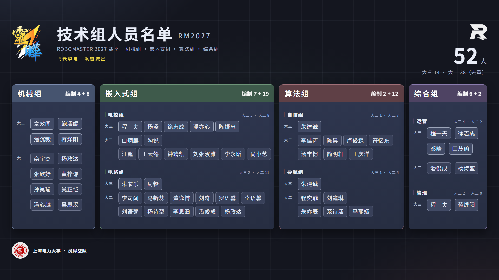
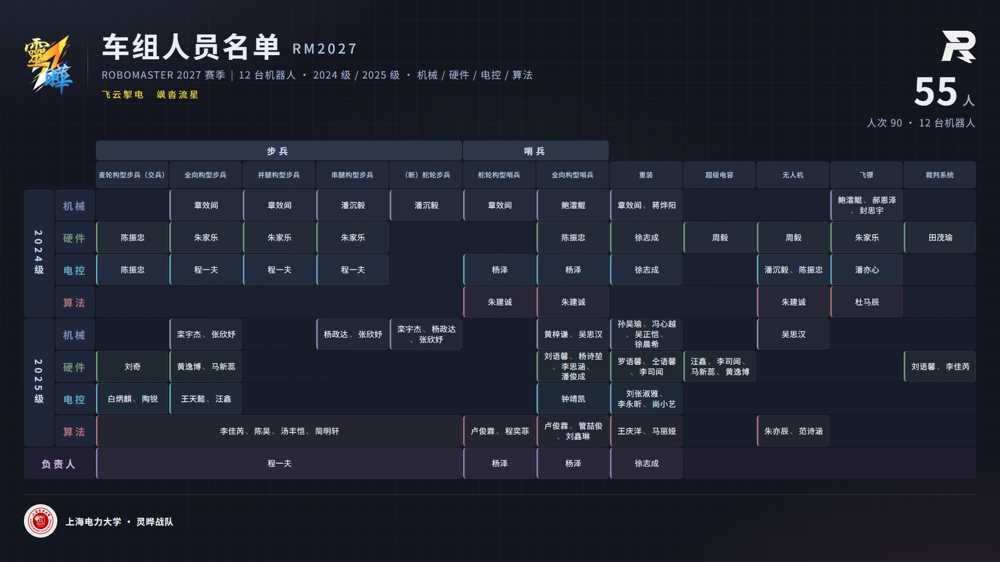

# RM2027 人员名单海报 · 灵晔战队

上海电力大学「灵晔」RoboMaster 战队 2027 赛季人员名单海报，**固定 1920×1080**，两页 **PPT 式自动播放**：

| 页面 | 内容 | 入口 |
| --- | --- | --- |
| 技术组名单 | 机械组 / 嵌入式组（电控组·电路组）/ 算法组（自瞄组·导航组）/ 综合组（运营·管理），4 张大卡 | 默认页 |
| 车组名单 | 12 台机器人（步兵 5 构型 / 哨兵 2 构型 / 重装 / 超级电容 / 无人机 / 飞镖 / 裁判系统）× 2 个年级 × 4 个方向 + 负责人行 | `?page=cars` |

技术栈：**Vite 8 + React 19 + TypeScript 6 + Tailwind CSS 4**。

## 预览

| 技术组名单 | 车组名单 |
| --- | --- |
|  |  |

（图片由 `scripts/verify.ps1` 生成，即 `pnpm dev` 下 `?page=tech` / `?page=cars` 的 1:1 截图）

## 自动播放（默认开启）

打开即循环播放，**默认每 12 秒换页**，淡入过渡 700ms，没有可见控件。

- **不会把屏幕切黑**：新页在最上层淡入，旧页延迟一个过渡时长再熄灭，过渡期间始终有一页是不透明的。
- **页面不可见自动暂停**（切标签 / 锁屏 / 屏幕被盖），可见后重新计时——数字标牌的标准做法。
- 自动播放时会申请 **Screen Wake Lock**，防止展示时显示器休眠（浏览器不支持或被策略拒绝则静默跳过）。
- 换页时 URL 同步 `?page=`，刷新后停在同一页。

**手动切换**（与自动播放并存，全程无可见控件）：

- **鼠标滚轮 / 触控板**上下（或左右）滑动翻页。一次手势只翻一页：累积位移过 40px 才翻，翻页后 900ms 冷却、冷却期内的残余事件全部丢弃，220ms 无新事件视为手势结束；方向反转会清空累积；`Ctrl+滚轮`（掰合缩放）不拦。
- 键盘：`←` `→` `↑` `↓` 翻页（按页序前进/后退，两页时互为切换）· `1` / `2` 直接跳页 · `空格` 暂停/继续自动播放 · `F` 全屏。
- 任何手动操作都会把自动播放的停留计时**重置为完整间隔**。

## 改名单（配置化）

名单是**数据，不是代码**：改 `public/data/` 下的两个 JSON 就能改海报，**保存后刷新页面即可，不用重新构建、不用碰 TypeScript**。

| 文件 | 内容 |
| --- | --- |
| `public/data/tech.json` | 技术组：4 张卡（分组名 / 配色 / 卡宽）+ 每组的子组与「大三 g3 / 大二 g2」名单 |
| `public/data/cars.json` | 车组：**一台车一条** —— `robots[]`（车名 `name`、一级分组 `group`、负责人 `lead`、按年级分块的名单 `crew`）+ 年级顺序 `grades` + 工作行与配色 `disciplines` + 负责人行 `leadRow` |

车组数据长这样（跨多台车由同一批人负责的，每台车各写一遍，海报上按车逐格显示、不做跨列合并）：

```json
{
  "name": "全向构型步兵",
  "group": "步兵",
  "lead": "程一夫",
  "crew": {
    "2024级": { "机械": ["章效闻"], "硬件": ["朱家乐"], "电控": ["程一夫"] },
    "2025级": {
      "机械": ["栾宇杰", "张欣妤"],
      "硬件": ["黄逸博", "马新蕊"],
      "电控": ["王天懿", "汪鑫"],
      "算法": ["李佳芮", "陈昊", "汤丰恺", "简明轩"]
    }
  }
}
```

- 车的数组顺序 = 海报上从左到右的列顺序；`group` 相邻同名会自动合并成一条跨列标题（不用写 span）。
- 行 = `grades` × `disciplines` 顺序；某车某年级某工作没人就不写，格子留空。
- 工作名、年级名写错会直接报错并列出可用值（不会静默少人）。

两个文件头部都有一段 `$comment`，逐字段说明了怎么改。要点：

- 页眉人数、人次、卡角标「编制 x + y」、「大三 14 · 大二 38（去重）」、跨组兼任——**全部由 JSON 实时算出**，JSON 里不写死任何数字。
- 改坏了不会白屏：JSON 语法错误、字段类型不对、列号越界等情况，页面上会直接显示「哪个文件 · 哪个字段 · 哪里不对」。
- `tech.json` 的四张卡宽度之和 + 3 个 18px 间隔应等于内容区 1828px，不符时控制台会有警告（页面上会溢出或留白）。
- 车组页行数由 JSON 决定（块内行数可变）；总行数超过 9 行时行高会自动压缩，保证仍塞进 680px 内容带。
- 数据是**运行时 fetch** 读取的，所以必须经 http 服务打开（`pnpm dev` / `pnpm preview` / 任意静态服务器）；直接双击 `dist/index.html`（`file://`）会被浏览器拦下 fetch。

## 设计语言（两页共用一套）

配色、圆角、字号只在 `src/index.css` 的 `@theme` 里定义一次，组件里不再出现写死的 `#hex` 文字色。

| 类别 | token | 取值 |
| --- | --- | --- |
| 文字（三级，不增第四个） | `ink` / `dim` / `faint` | 名字与标题 / 说明与年级标签 / 页脚与次要信息 |
| 面 `surface-0…4` | `--color-surface-*` | 行底衬 2 档（0/1）、结构标签块（2）、列头（3）、跨列顶栏（4） |
| 面（专用） | `surface-lead` / `chip` / `chip-strong` / `card-top`、`card-bottom` | 负责人带 / 大二胶囊 / 大三胶囊 / 卡片渐变 |
| 描边（三档） | `hair` / `edge` / `edge-strong` + `inset` | 分隔线 / 普通块 / 强调块 / 块内描边 |
| 圆角（三档） | `radius-card` 14 / `radius-block` 8 / `radius-bar` 2 | 卡片与面板 / 所有内部块 / 3px 竖条 |
| 字号（唯一层级表） | `display` 54 · `stat` 72 · `cardtitle` 28 · `badge` 26 · `statunit` 24 · `label` 19 · `group` 17 · `body` 21 · `cell` 15 · `meta` 14.5 · `colhead` 13 | 两页只用这些 |
| 分组配色 | `mech`/`embed`/`algo`/`misc`/`ctrl` + JSON 里的 `accent` | 技术组卡头、车组行标签与格子 |

两个共用构件：

- **`.accent-bar`：3px 竖条** —— 「带配色的标签」统一记号。技术组的子组标题、车组的行标签都用它，宽度/圆角/上下内缩都相同。
- **人名块**：技术组是胶囊（`radius-block` + 中性描边 + `body` 21px），车组是格子（`radius-block` + 方向色 1A 底 + 3px 竖条 + `inset` 内描边 + `cell` 15px）——密度不同，构件语言一致。

### 海报脊柱（对齐规则）

两页共用一条纵向骨架；`?diag=1` 会直接把它打出来（`脊柱 …` 一行）：

| 位置 | y | 说明 |
| --- | --- | --- |
| 页眉 | 52 → 236 | 只有一套规格（`--head-h` 184），两页共用 `PosterHeader` |
| 内容带 | 266 → 946 | `--band-h` 680，两页同高：技术组 = 四张卡；车组 = 顶栏 44 + 列头 58 + 9 行 × 62 |
| 页脚 | 957 → 1040 | `mt-auto` 钉在舞台下内边距上，两页自动同 y |

- **技术组行带固定**：`--band-title` 26 / `--band-g3` 100（容 2 行胶囊）/ `--band-g2` 154（容 3 行胶囊），行内顶部对齐 —— 四张卡的「大三」「大二」因此落在同一 y（`?diag=1` 的 `年级行 y` 四组必须一致，`行标签 vs 胶囊文字中心` 的 Δ 应为 0）。
- **卡宽与行带联动**：`tech.json` 的 `width` 是按「大三 ≤ 2 行、大二 ≤ 3 行胶囊」配的，卡太窄会把名单折出行带。加人之后先看 `?diag=1` 的 `行带溢出`（撑破会直接报出哪个子组哪一行超了多少 px）。
- **车组列宽**：12 列等宽 139px，首列左 184、末列右 1874（= 内容区 1828 的左右边界）；`?diag=1` 的 `列宽去重` 应只有一档。
- 四张卡里内容少的（机械组只有 1 个子组）**底部会留白**：这是「行对齐」的代价，卡片外框仍然四张齐平。

## 快速开始

```bash
pnpm install
pnpm dev            # http://localhost:5173
pnpm build          # 产物在 dist/
pnpm preview        # 预览构建产物 :4173
pnpm lint           # oxlint
```

### URL 参数

| 参数 | 作用 |
| --- | --- |
| `?page=tech` \| `?page=cars` | 指定初始页 |
| `?auto=0` | 关掉自动播放（配截图/调版用） |
| `?every=6000` | 换页间隔，单位毫秒，默认 `12000` |
| `?bare=1` | 强制 1:1（截图 / 导出口径） |
| `?scale=1` | 同上，但不影响其它行为 |
| `?diag=1` | 页面左上角输出布局量测（溢出元素、图片加载、卡内留白、当前页…） |
| `?wheel=1` | 仅调试：自动播一次滚轮手势并回报结果（供 `verify.ps1` 断言） |

## 出图 / 自检脚本

```bash
# 起 dev server → 两页各截一张 1920x1080 PNG 到 shots/ → 打印 DIAG 量测 → 自检自动播放与滚轮翻页
pwsh -File scripts/verify.ps1

# 与任意同尺寸海报做像素级比对（输出差异比例、差异包围盒、差异高亮图）
python scripts/pixel-diff.py shots/tech-1920x1080.png 参考图.png 输出差异图.png

# 量某张海报的「布局指纹」：卡片页眉色带、每行胶囊的 y 区间与左右端
python scripts/layout-probe.py shots/tech-1920x1080.png

# 逐卡逐行比较两张海报的胶囊行位置（Δy / Δx）
python scripts/row-compare.py 参考图.png shots/cars-1920x1080.png
```

`verify.ps1` 里用的是 Windows 上的 Chrome：
`--headless=old --window-size=1920,1080 --force-device-scale-factor=1 --screenshot=...`。
注意 `--headless=new` 会带上窗口边框，截出来是 1936×1175，必须用 `old`。

## 目录

```text
src/
  App.tsx                 页序 / 键盘 / 自动播放装配；名单读取中与出错时的兜底
  components/
    Stage.tsx             固定 1920x1080 舞台 + 多页叠层淡入（StageStack）
    PosterHeader.tsx      页眉：战队 logo + 标题 + 副标题 + 口号 + 右上统计
    PosterFooter.tsx      页脚：上海电力大学校徽 + 校名（两页共用）
    TechRoster.tsx        技术组名单页（4 张大卡）
    CarMatrix.tsx         车组名单页（矩阵，列/行数由 JSON 决定）
    Diag.tsx              ?diag=1 时的量测叠加层
  data/
    roster.ts             名单的类型 / JSON 校验 / 统计口径（不含具体名单）
  hooks/
    useRosterData.ts      读取 public/data/*.json 并校验，加载完才挂载海报
    useChipBalance.ts     胶囊折行平衡（避免末行孤儿）
    useAutoPlay.ts        自动播放计时（含页面不可见暂停）
    useWheelNavigate.ts   滚轮 / 触控板手势翻页（阈值 + 冷却，一次手势一页）
    useScreenWakeLock.ts  展示时防止屏幕休眠
  lib/util.ts             舞台尺寸、页面清单、素材与数据路径
  index.css               Tailwind 入口 + 设计令牌 + 海报画布
public/assets/            logo / 校徽等位图素材
public/data/              名单配置（tech.json / cars.json）—— 改名单只改这里
scripts/                  出图与自检脚本（PowerShell + Python）
```

### 为什么没引第三方轮播库

调研过的开源方案与不采用的原因：

- **reveal.js**（[auto-slide 文档](https://revealjs.com/auto-slide/)）：能力最贴近，`autoSlide: 5000` + `loop: true` 就能自动播，`autoSlideStoppable: false` 可关掉「一交互就暂停」。但它是**整站演示框架**：接管 DOM 结构、主题、排版与 `Reveal.initialize()` 生命周期，默认还会渲染一个播放/暂停控件；与「固定 1920×1080 海报 + 像素级对齐 + 无可见控件」都冲突。另外它的文档里没有「页面不可见时暂停」的行为，而这是标牌场景的刚需。
- **embla-carousel / Swiper / keen-slider / react-slick** 这类轮播库：擅长拖拽、无限列表、几十张幻灯片；本场景只有 2 张固定画布，引入后仍要自己解决固定舞台缩放、1:1 截图、无 UI 等问题，收益为负（Swiper 还要额外引 CSS）。
- **自己写**：`useAutoPlay` 约 40 行，换来完全可控的行为——「新页盖旧页」淡入（过渡期间不变暗）、`visibilitychange` 暂停、`Screen Wake Lock` 防休眠，以及 `?auto=0` 让截图流程确定。

## 数据口径

数据源：`rm2027人员分配.xlsx`（`车组人员名单`、`技术组人员名单` 两张表），已转成 `public/data/tech.json` 与 `public/data/cars.json`（运行时读取，见上一节）。

- **技术组**：表内 60 个人次 = **52 人**（大三 14 / 大二 38）。跨组兼任导致重复：程一夫 ×3，朱建诚 / 蒋烨阳 / 杨政达 / 徐志成 / 潘俊成 / 杨诗堃 各 ×2。
  卡片角标写「**编制 x + y**」（= 名额数，含重复），页眉写「**52 人 / 大三 14 · 大二 38（去重）**」——两套口径都是真实值，不做文字解释。
- **车组**：**55 人 / 110 人次**（一台车一条、同一人管多台车就在每台车里各写一遍，所以人次按车重复计：90 → 110 的差来自「2025 级算法的步兵 4 人 ×5 台」与「步兵负责人程一夫 ×5 台」）。海报上按车逐格显示，不做跨列合并（原表的合并单元格已在转 JSON 时按覆盖的车展开）。
- **姓名不一致**：`车组人员名单` 某格写作「潘艺心」，`技术组人员名单` 写作「潘亦心」，两处统一按技术组表的 **潘亦心**（`public/data/cars.json` 里已是「潘亦心」）。

## 设计说明

- **配色**沿用技术流程图取色：机械组 `#46546F`、嵌入式组 `#3E5A4B`、算法组 `#5F4046`、综合组 `#4E4363`（车组页另加电控 `#5FA0B8`、负责人 `#8B7CAE`）。底色 `#14161F`，主文字 `#E9EDF8`。
- **令牌是唯一出处**：`src/index.css` 的 `@theme`（颜色/圆角/字号）+ `:root`（脊柱：`--band-h` / `--head-h` / `--band-g3` / `--band-g2` …）。组件里不写死颜色与字号，改一处两页一起变。
- ⚠️ **`.poster-canvas` 上的 `line-height: normal` 不能删**：Tailwind Preflight 会把默认行高改成 `1.5`，而这张海报的排版是按浏览器默认行高定的，删掉会让卡内文字整体偏移（已用像素比对验证）。
- 校徽按《上海电力大学 VI 手册》使用：标准红 **`#CC0000`（R204 G0 B0 / C26 M100 Y100 K0）**、官方制图原样不改内部要素；`public/assets/school-seal-clean.png` 是修好缺口与邻近残字后的正圆白盘版（四角 alpha=0、主红实测 `#CC0000`）。VI 未规定深色底的用法，故不采用自制的「白墨版」。

## 与旧版的关系（旧像素基线已失效）

本版做过一次**统一视觉语言的重设计**：页眉改成单一规格、两页共用 680px 内容带与同一 y 的页脚、四张卡改成固定行带对齐、配色全部收进 token、车组行标签改为「3px 竖条 + 19px 粗体」。因此与重设计前的截图**不再逐像素可比**；`shots/` 里的图是更早的 Windows Chrome 出图，只作内容口径参考。

要判断某次改动有没有影响排版，别用 `shots/` 做基线，用**同机基线法**：

```bash
git worktree add --detach /tmp/base HEAD        # 改前的代码
cd /tmp/base && pnpm install && pnpm build && pnpm preview --port 4174 &
cd - && pnpm build && pnpm preview --port 4173 &
# 同机同 Chrome 各截一张，再逐像素比对
python scripts/pixel-diff.py /tmp/base-tech.png /tmp/new-tech.png /tmp/diff.png
```

## 踩过的坑

- 删掉/改名模块（如把 `Switcher.tsx` 删掉、`Stage` 改名 `StageStack`）之后，**已经在跑的 dev server 会处于陈旧状态，页面直接白屏**——重启 `pnpm dev` 即可。`verify.ps1` 里截图只有几 KB 基本就是这个原因。
- Tailwind Preflight 会改默认行高，见上方设计说明。
- **名单是运行时 fetch 的**：`file://` 直接打开会被浏览器拦掉 fetch；截图脚本要保证 fetch 已完成（headless Chrome 会等网络静默，实测带不带 `--virtual-time-budget` 都能截到完整海报）。
- 页面上出现「名单数据读取失败」= JSON 有问题，提示里直接给出文件与字段路径，改完刷新即可。
- **行带是被卡宽和名单长度共同撑的**：加人后先跑 `?diag=1` 看 `行带溢出`，别等出图才发现被裁。
- **「大三 / 大二」标签与首枚胶囊的文字中心对齐**靠 `pt-[25px]`：这个值是按胶囊高度（`py-9` + `body` 21px 行高）算出来的，改胶囊内边距/字号时要一起调（`?diag=1` 的 `行标签 vs 胶囊文字中心` 会告诉你差多少）。
- Chrome 的启动器是异步返回的：脚本里必须 `Start-Process -Wait` + 等文件落盘，否则截图读不到。

## 待办

- [ ] 车组页矩阵行高 62px 下，3 人以上的格子接近贴边，可考虑字号自适应。
- [ ] 技术组「机械组」卡（只有 1 个子组）底部留白 ~280px：若要填满，需改成每张卡各自撑满（代价是卡与卡之间的行不再对齐）。
- [ ] 若要在展示机上长期跑，可考虑：隐藏鼠标光标（闲置 3 秒后 `cursor: none`）、加一条极细的播放进度线。
